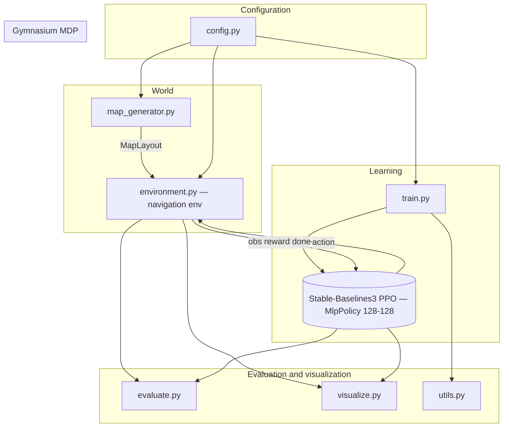
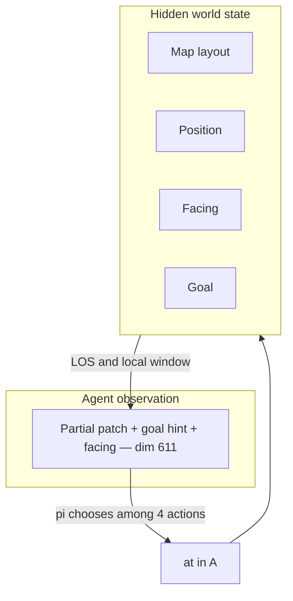
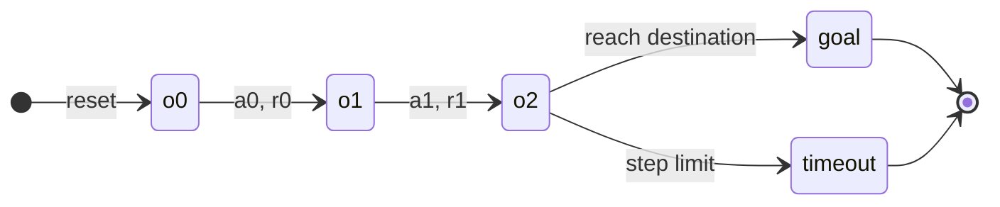
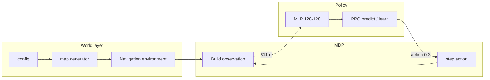
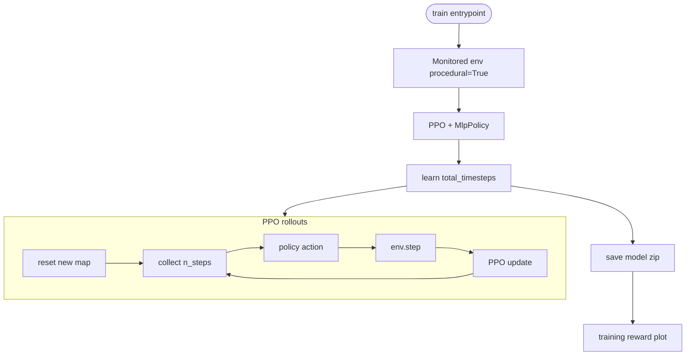
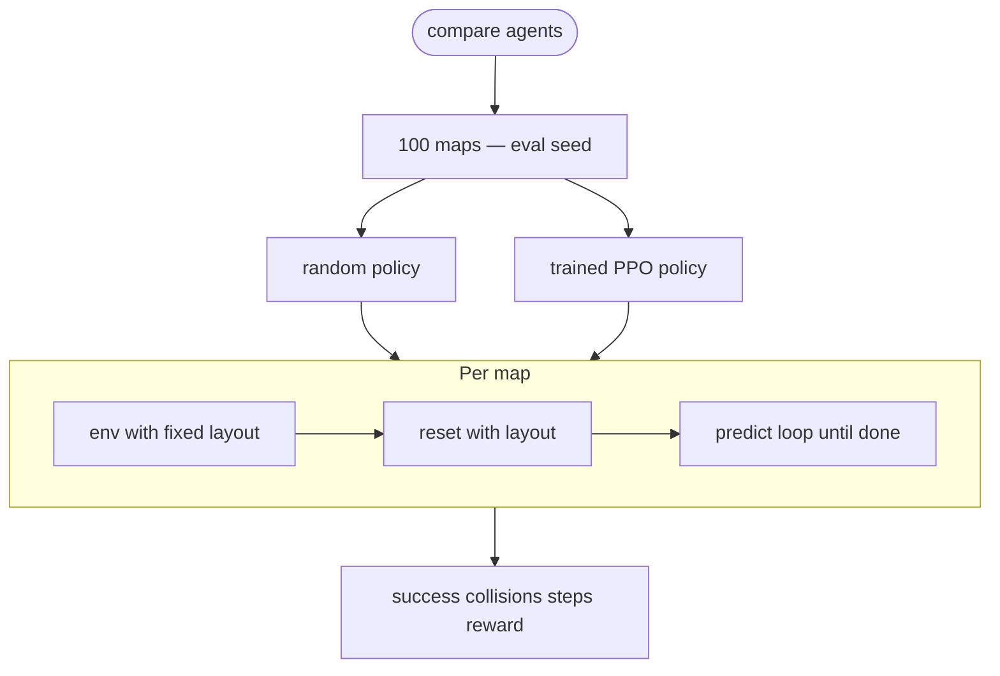
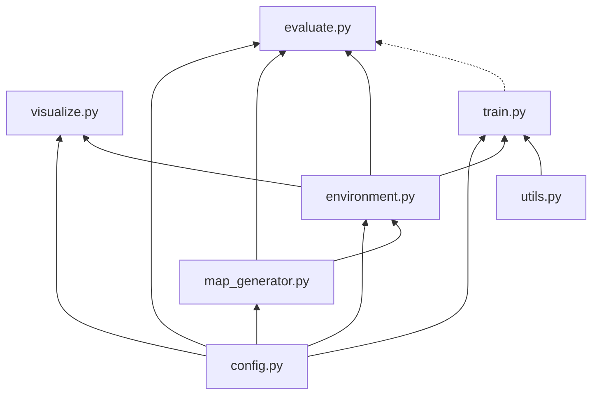

# Banana Bots RL Sandbox — Architecture & RL Guide

Compiled overview of the navigation RL prototype: structure, theory, diagrams, and file reference. For full product requirements see [`banana_bots_rl_onboarding_spec.md`](../banana_bots_rl_onboarding_spec.md).

---

## 1. Project goal

Build a **2D reinforcement-learning navigation sandbox** inspired by assistive navigation glasses. This prototype does **not** replace a computer-vision stack; it uses a controlled simulator and partial observations to study:

> Can an RL policy trained on many randomized layouts **navigate safely** and **generalize** to maps it never saw during training?

**Real system vs prototype**

| Real Banana Bots | This prototype |
|------------------|----------------|
| Camera → CV model → navigation | 2D grid → local observation → learned policy (PPO + MLP) |

The environment API is modular so observations could later be swapped for CV features.

**Stack:** Python, Gymnasium, Stable-Baselines3 (PPO), MLP policy, optional Pygame/Matplotlib.

---

## 2. High-level architecture



**Training data flow**

1. Each `reset()` builds or loads a grid (procedural or fixed layout).
2. Environment returns a **vector observation** (local patch + goal direction + facing).
3. Policy outputs one of **four** body-relative moves.
4. Environment applies dynamics, **reward**, termination/truncation.
5. PPO collects rollouts and updates weights; training saves model and reward plot.

---

## 3. RL components (theory ↔ this project)

| RL concept | Role here |
|------------|-----------|
| **Environment** | Grid dynamics, rewards, episode limits |
| **Observation** \(o_t\) | Partial view — not the full map |
| **Action** \(a_t\) | Discrete move relative to facing |
| **Transition** | Move or collision-in-place; LOS updates what is visible |
| **Reward** \(r_t\) | Goal, collision, grass, per-step cost |
| **Episode** | Ends at goal or max steps (200 default) |
| **Policy** \(\pi(a \mid o)\) | MLP → categorical over 4 actions |
| **Algorithm** | PPO (on-policy actor–critic, clipped updates) |
| **Training distribution** | New random solvable map each episode |
| **Generalization test** | 100 fixed held-out maps (`EVAL_SEED`) |

### Partial observability

The policy never receives the full \(12 \times 12\) grid. It gets a **local agent-centric patch** with **line-of-sight** masking (obstacles block sight). Observations also include a **normalized vector toward the goal** and **one-hot facing** so decisions are Markov with respect to what the policy sees.

### PPO (external library)

Training uses Stable-Baselines3 PPO with `MlpPolicy`, `net_arch=[128, 128]`, ReLU. Rollouts → advantage estimates → clipped policy gradient updates. Hyperparameters live in `config.py` and `train.py`.

### Rewards (defaults in `config.py`)

| Event | Reward |
|-------|--------|
| Reach goal | +100 |
| Collision (no move into obstacle/wall) | −20 (+ step penalty) |
| Step on grass | −1 |
| Every step | −0.1 |

Collisions **do not** terminate the episode; the agent stays put.

### Actions

| Index | Meaning |
|------:|---------|
| 0 | Forward (relative to facing) |
| 1 | Backward |
| 2 | Strafe left |
| 3 | Strafe right |

Facing: N / E / S / W (4 orientations). Moves are body-relative.

### Observation size (default config)

- Patch side: \(2 \times \texttt{VIEW\_DISTANCE} + 1 = 11\)
- Patch: \(11^2 \times 5\) one-hot channels (empty, grass, obstacle, goal, unknown)
- Plus 2: normalized \((\Delta row, \Delta col)\) to goal
- Plus 4: facing one-hot  
- **Total: 611** float32 dimensions

---

## 4. What the agent is supposed to do

On each episode:

1. Start at a random position and facing on a **new random map** (training) or a **fixed held-out map** (eval).
2. Navigate on walkable cells, **avoid obstacles**, prefer clear path over **grass** when practical.
3. **Reach the goal** within the step limit.

**Evaluation:** Compare **success rate**, **collision rate**, **steps to goal** (successes), and **average reward** against a **uniform random** action baseline on the same held-out maps.

---

## 5. RL strategy (class-agnostic)

### Core loop (every timestep)

```mermaid
flowchart TB
    subgraph Episode [One episode]
        INIT([Start — sample world and initial observation o0])
        INIT --> LOOP
    end

    subgraph LOOP [Each step t]
        S[Observation ot]
        POL[Policy pi — observation to action]
        A[Action at in 0,1,2,3 — |A| = 4]
        ENV[Environment dynamics and reward]
        DONE{Terminal? goal or step limit}

        S --> POL --> A --> ENV
        ENV --> S2[Next observation ot+1]
        ENV --> R[Reward rt]
        R --> DONE
        S2 --> DONE
        DONE -->|no| S
        DONE -->|yes| END([End episode])
    end

    subgraph Learning [Training only]
        BUF[Store trajectories]
        UPD[Update pi to improve expected return]
        LOOP -.-> BUF -.-> UPD -.-> POL
    end
```

**Strategy:** Maximize **expected cumulative reward** by learning \(\pi(a \mid o)\) from many episodes on random maps, then test on **unseen** layouts.

### How many actions?

**\(|\mathcal{A}| = 4\)** discrete choices at every decision step.

### How many states?

Two levels:

1. **Hidden world state** (simulator truth): map layout × agent cell × facing × goal. Layouts are **procedural per episode** → enormous / unbounded set of worlds. On a **fixed** map: roughly **(walkable cells) × 4** facings → order **10²–10³** agent configurations.
2. **Policy observations** \(o_t \in \mathbb{R}^{611}\): continuous → uncountably many distinct inputs; the MLP does not use a small discrete state table.



### Moving across “states”

Episodes are **1 … 200** decision steps. At each \(o_t\), the agent picks one of **4** actions; \(o_{t+1}\) reflects movement, collisions, and changed visibility.



---

## 6. End-to-end runtime flow



---

## 7. Training pipeline



**Defaults:** `TOTAL_TIMESTEPS = 50_000`, model path `models/ppo_navigation.zip`.

---

## 8. Evaluation & generalization



Training uses **procedural** maps; evaluation uses **`generate_eval_maps`** with `EVAL_SEED` (not mixed into training resets).

---

## 9. File reference

| File | Purpose |
|------|---------|
| `banana_bots_rl/config.py` | Grid, view distance, rewards, map densities, PPO/eval seeds, paths |
| `banana_bots_rl/map_generator.py` | `MapLayout`, `generate_map`, BFS solvability, `generate_eval_maps` |
| `banana_bots_rl/environment.py` | Gymnasium env: `reset`, `step`, observation, LOS, rewards |
| `banana_bots_rl/train.py` | PPO training, callbacks, save model, reward plot |
| `banana_bots_rl/evaluate.py` | Held-out metrics, random vs PPO, `EvalSummary` |
| `banana_bots_rl/visualize.py` | RGB frames, Pygame playback, notebook animation |
| `banana_bots_rl/utils.py` | `rolling_mean` for plots |
| `banana_bots_rl/manual_test_env.py` | Smoke test without RL |
| `banana_bots_rl/__init__.py` | Exports main env class |
| `README.md` | Setup and quick start |
| `banana_bots_rl_onboarding_spec.md` | Full design spec and stretch goals |

### Important functions (by module)

**map_generator:** `generate_map`, `path_exists`, `generate_eval_maps`, `MapLayout`

**environment:** `AssistiveNavigationEnv.reset`, `step`, `_build_observation`, `_is_visible`, `_line_clear`, `_agent_to_world`

**train:** `build_model`, `train`, `EpisodeMetricsCallback`, `plot_training_rewards`

**evaluate:** `run_episode_on_layout`, `evaluate_on_maps`, `compare_agents`, `sb3_policy`, `random_policy`

**visualize:** `render_grid_to_array`, `play_episode_pygame`, `show_frames_in_notebook`

---

## 10. Quick reference numbers

| Concept | Value |
|---------|------:|
| Actions \(\|\mathcal{A}\|\) | 4 |
| Max steps per episode | 200 |
| Observation dimension | 611 |
| Facings | 4 |
| Grid | 12 × 12 |
| View distance (LOS radius) | 5 |
| Held-out eval maps | 100 |
| Training timesteps (default) | 50,000 |

---

## 11. Practical workflow

```bash
pip install -r banana_bots_rl/requirements.txt
python -m banana_bots_rl.manual_test_env   # optional smoke test
python -m banana_bots_rl.train --timesteps 50000
python -m banana_bots_rl.evaluate          # random baseline
```

After training, load the saved zip and run `compare_agents(model)` from `evaluate.py` (see `README.md`).

**Note:** Training callbacks primarily log episode **reward** via Monitor; full success/collision curves during training may need forwarding env `info` on episode end. **Evaluation** reports success and collisions correctly via `run_episode_on_layout`.

---

## 12. Package dependencies (logical)



---

*Generated as a consolidated onboarding reference for the Banana Bots RL navigation sandbox.*
